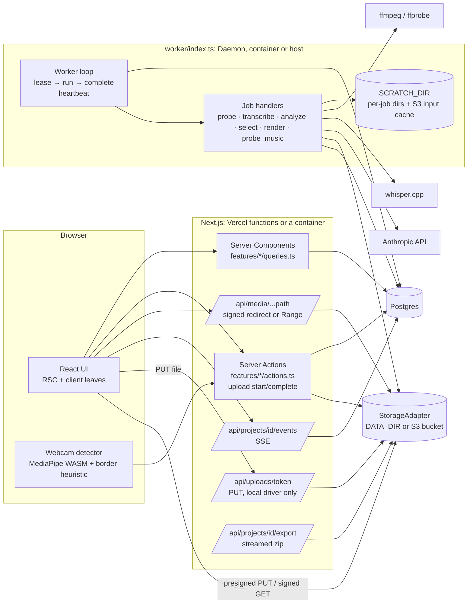
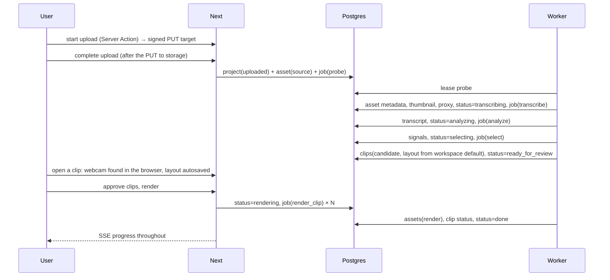

# Architecture

Nimbus is one Next.js app plus one long-running Node worker process. They share a Postgres database and media storage: a data directory on local disk (`STORAGE_DRIVER=local`, the default) or an S3-compatible bucket (`STORAGE_DRIVER=s3`). Run locally, nothing leaves the machine except optional calls to the Anthropic API and the Google (YouTube) APIs used for publishing and insights.

The web side never spawns a binary, so it can run on Vercel functions. The worker is one image (`Dockerfile.worker`, with ffmpeg, whisper.cpp, yt-dlp and the model) that runs as a Vercel Daemon in production or under Docker Compose when self-hosted, and on the host with `pnpm dev`. See ADR-0070 and [DEPLOY.md](DEPLOY.md).

## System diagram



## Request vs worker boundary

| Runs in a request (Next)             | Runs in the worker                             |
| ------------------------------------ | ---------------------------------------------- |
| Reading projects, clips, transcripts | ffprobe, audio extraction, thumbnails, proxies |
| Validating and persisting user edits | whisper.cpp transcription                      |
| Enqueuing jobs                       | silencedetect / ebur128 analysis               |
| Signing upload targets, completing   | Highlight selection (LLM or heuristic)         |
| Serving media (signed URL or Range)  | Rendering clips and the horizontal edit        |
| Streaming job progress over SSE      | Probing music and its waveform peaks           |
| Reading worker heartbeat in settings | Orphan sweeping, temp cleanup, disk checks     |

A request never waits on ffmpeg, whisper or an LLM call. Mutations that kick off work insert a row into `jobs` and return. The one exception is the Manual LLM selector, where the user pastes JSON that is validated and post-processed synchronously (pure code, milliseconds).

The web process never spawns ffmpeg, ffprobe, whisper or yt-dlp and never checks disk space. Modules that do (anything importing `lib/process/run`, such as `features/render/ffmpeg-runner.ts`, `features/transcription/whisper-cpp.ts`, `features/downloads/yt-dlp.ts` and their callers like `features/highlights/frames.ts`) are reached only from job handlers in the worker, plus `scripts/doctor.ts`. The settings page reads ffmpeg capabilities from the worker's row in `worker_heartbeats` and shows "No worker online" when it is more than 3 minutes old.

## Uploads and media

- Uploads go from the browser straight to storage, at the file's final key (`projects/<id>/source.<ext>` or `music/<workspace>/<track>.<ext>`; the id is minted when the upload starts). On S3, `startUploadAction` starts a multipart upload (parts of 64 MiB or more, at most 10,000) and the browser asks `signUploadPartsAction` for part URLs in batches, PUTs up to four parts at a time and retries a failed part twice with a fresh URL. On the local driver the target is `/api/uploads/[token]`, which streams the body to the final key through a `.part` temp. The token's `exp` (1 h) gates the local PUT; its `completeBy` (24 h) gates part signing and completion. `completeUploadAction(token, parts)` assembles the parts, checks the size and that the first bytes match the claimed format, then creates the project or music track; on failure it removes the object or aborts the multipart upload. The sweep removes final keys whose row never appeared after 24 h and aborts multipart uploads older than 24 h.
- Music tracks stay `processing` until a `probe_music` job has probed them and computed their peaks.
- `/api/media`, `/api/music` and `/api/avatars` redirect to a signed GET URL (4 h) when the driver has one, and stream with `Range` when it doesn't (local).

## Worker scratch

Each job gets `SCRATCH_DIR/<jobId>-<attempt>` (`ctx.scratch`), removed when the handler settles. Steps take inputs with `storage.localCopy(key, scratch)` and hand outputs back with `putFile` (or `produceFile`); they never build paths into storage. On the local driver `localCopy` returns the stored file and `putFile` renames into place, so it costs nothing. The S3 driver downloads into a shared cache under `SCRATCH_DIR/cache`, keyed by key and ETag, bounded by `SCRATCH_CACHE_BYTES` with least-recently-used eviction, and hard-links entries into the job's scratch so eviction never removes a file in use.

## Pipeline data flow



Each step handler is responsible for: reading its inputs, doing the work, writing outputs, transitioning the project through the state machine and enqueuing the next job, in that order. Transition and enqueue happen in one transaction.

## Folder structure

```
app/                 routes only: pages, layouts, route handlers, loading/error UI
  (app)/             app shell with sidebar
  (editor)/          full-height clip editor: the sidebar without the header
  dev/components/    component gallery (404 in production)
  api/               uploads, media, SSE
components/
  ui/                shadcn + shadcn-style primitives
  app-shell/         sidebar, page header, command palette
  <domain>/          app-specific composites (projects, clips, captions, layout-fields…)
features/<name>/     domain logic per feature
lib/                 db, env, logger, storage, sse, result/errors, utils
worker/              worker entry point
scripts/             doctor, fixtures, migrations, storage push
tests/               integration, contracts, e2e, fixtures, utils
docs/
```

Import direction: `app → components → features → lib`. `features` never imports `app` or `components`. `lib` never imports runtime code from `features`; the one exception is `lib/db/schema.ts`, which imports domain _types_ (`import type`) for JSON columns.

## Adapter interfaces

All external capabilities sit behind interfaces so tests can swap them and the stack can change later.

```ts
interface StorageAdapter {
  // LocalStorage (DATA_DIR) or S3Storage, picked by STORAGE_DRIVER
  write(
    key: string,
    body: Readable,
    opts?: { maxBytes?: number; transforms?: Transform[] }
  ): Promise<{ bytes: number }>
  writeBuffer(key: string, data: Buffer | string): Promise<void>
  stat(key: string): Promise<{ bytes: number; mtimeMs: number } | null>
  read(key: string, range?: ByteRange): Readable
  remove(key: string): Promise<void>
  removePrefix(prefix: string): Promise<void>
  list(prefix: string): Promise<string[]>
  listWithInfo(prefix: string): Promise<StoredEntry[]> // key, bytes, mtimeMs from the listing
  localCopyCost(bytes: number): number // scratch bytes a localCopy needs (0 on local)
  localCopy(
    key: string,
    scratchDir: string,
    signal?: AbortSignal
  ): Promise<string> // read-only: on local it is the stored file itself
  putFile(file: string, key: string): Promise<{ bytes: number }> // consumes the file
  readUrl(key: string, opts?: { download?: string }): Promise<string | null>
  uploadTarget(
    key: string,
    opts: { bytes: number; contentType: string }
  ): Promise<UploadTarget | null> // S3: starts a multipart upload; local: null (the app's PUT route)
  signUploadParts(
    key: string,
    upload: { uploadId: string; bytes: number; partSize: number },
    partNumbers: readonly number[]
  ): Promise<Array<{ partNumber: number; url: string }>>
  completeUpload(
    key: string,
    uploadId: string,
    parts: readonly UploadedPart[]
  ): Promise<void>
  abortUpload(key: string, uploadId: string): Promise<void>
  abortStaleUploads(before: Date): Promise<number> // no-op on local
  usage(prefix?: string): Promise<{ bytes: number; files: number }>
}

interface Transcriber {
  readonly id: string
  transcribe(input: {
    audioPath: string
    language?: string
    signal?: AbortSignal
    onProgress?: (pct: number) => void
  }): Promise<RawTranscript>
}

interface HighlightSelector {
  readonly id: "anthropic" | "manual" | "heuristic"
  select(input: SelectionInput): Promise<HighlightCandidate[]> // raw; post-processing is shared
}
```

`ProcessRunner` wraps `child_process.spawn` for ffmpeg/ffprobe/whisper with timeout, abort and stderr-tail capture. Pure builders (`features/render/filtergraph.ts`, `features/captions/ass.ts`) produce argument arrays and file contents; only the runner touches processes.

## Persistence

- Postgres 17 via `pg` + Drizzle (`lib/db`). `docker-compose.yml` runs it on port 5442; `DATABASE_URL` points at it. JSON columns are `jsonb`, times are `timestamptz`.
- Every repository method is async. `withTransaction(db, async (tx) => …)` runs a transaction; code inside must use `tx`, not `db`, or it runs outside the transaction.
- The job queue claims work with `SELECT … FOR UPDATE SKIP LOCKED` inside a transaction, so any number of workers can lease without double-claiming.
- Repositories (`features/*/repository.ts`) are the only modules that issue queries, apart from the sweep step's three key lookups.
- Files live under `DATA_DIR` or in the bucket with the same keys, like `projects/<projectId>/source.mp4`, `projects/<projectId>/renders/<clipId>-<stamp>.mp4`. The DB stores keys, never absolute paths, so `pnpm storage:push` can move a local install to S3 without touching rows.

## Realtime

The worker writes `jobs.progress`, `jobs.detail` and project status to Postgres. `detail` is a small step-specific JSON object (`features/pipeline/detail.ts`: download bytes and speed, the transcript's last few hundred characters, a 240-point waveform, candidates found so far), written with the heartbeat at most every 500 ms, flushed before the job completes and cleared when it's leased again. The snapshot only includes it for running jobs. `/api/projects/[id]/events` polls the DB every 500 ms (the next poll starts after the previous one finishes) within the request and emits SSE events only when the snapshot changes, with a heartbeat comment every 15 s. The client falls back to `router.refresh()` polling if `EventSource` errors repeatedly.

## server-only in the worker

Server modules start with `import "server-only"`. That package throws unless resolved under the `react-server` export condition, so the worker runs as `tsx --conditions=react-server worker/index.ts` and Vitest aliases `server-only` to an empty module. See ADR-0016.
