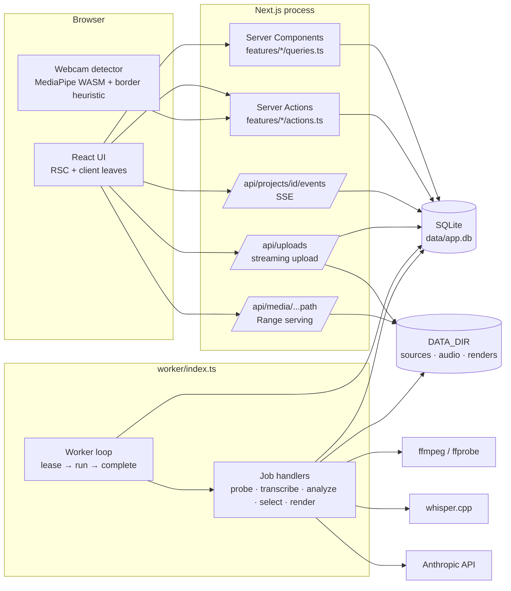
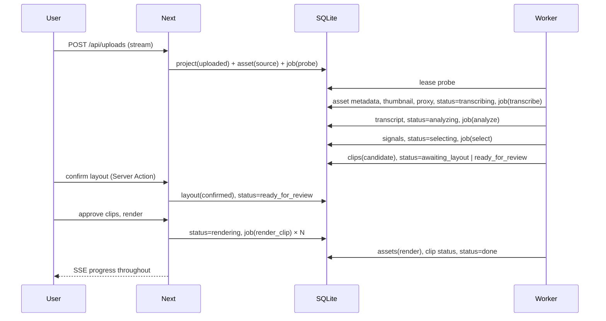

# Architecture

Auto-Clipper is one Next.js app plus one long-running Node worker process. They share a SQLite database and a data directory on local disk. Nothing leaves the machine except optional calls to the Anthropic API.

## System diagram



## Request vs worker boundary

| Runs in a request (Next) | Runs in the worker |
| --- | --- |
| Reading projects, clips, transcripts | ffprobe, audio extraction, thumbnails, proxies |
| Validating and persisting user edits | whisper.cpp transcription |
| Enqueuing jobs | silencedetect / ebur128 analysis |
| Streaming uploads to disk | Highlight selection (LLM or heuristic) |
| Serving media with Range | Rendering clips and the horizontal edit |
| Streaming job progress over SSE | Orphan sweeping, temp cleanup |

A request never waits on ffmpeg, whisper or an LLM call. Mutations that kick off work insert a row into `jobs` and return. The one exception is the Manual LLM selector, where the user pastes JSON that is validated and post-processed synchronously (pure code, milliseconds).

## Pipeline data flow



Each step handler is responsible for: reading its inputs, doing the work, writing outputs, transitioning the project through the state machine and enqueuing the next job, in that order. Transition and enqueue happen in one SQLite transaction.

## Folder structure

```
app/                 routes only: pages, layouts, route handlers, loading/error UI
  (app)/             app shell with sidebar
  dev/components/    component gallery (404 in production)
  api/               uploads, media, SSE
components/
  ui/                shadcn + shadcn-style primitives
  app-shell/         sidebar, header, breadcrumbs
  <domain>/          app-specific composites (projects, clips, captions, layout-editor…)
features/<name>/     domain logic per feature
lib/                 db, env, logger, storage, sse, result/errors, utils
worker/              worker entry point
scripts/             doctor, fixtures
tests/               integration, contracts, e2e, fixtures, utils
docs/
```

Import direction: `app → components → features → lib`. `features` never imports `app` or `components`. `lib` never imports `features`.

## Adapter interfaces

All external capabilities sit behind interfaces so tests can swap them and the stack can change later.

```ts
interface StorageAdapter {
  resolve(key: string): string              // absolute path inside DATA_DIR, throws on traversal
  writeStream(key: string, body: Readable, opts?: { maxBytes?: number }): Promise<{ bytes: number }>
  stat(key: string): Promise<{ bytes: number } | null>
  readStream(key: string, range?: { start: number; end: number }): Readable
  remove(key: string): Promise<void>
  usage(): Promise<{ bytes: number }>
}

interface Transcriber {
  readonly id: string
  transcribe(input: { audioPath: string; language?: string; signal?: AbortSignal;
                      onProgress?: (pct: number) => void }): Promise<RawTranscript>
}

interface HighlightSelector {
  readonly id: "anthropic" | "manual" | "heuristic"
  select(input: SelectionInput): Promise<HighlightCandidate[]>  // raw; post-processing is shared
}
```

`ProcessRunner` wraps `child_process.spawn` for ffmpeg/ffprobe/whisper with timeout, abort and stderr-tail capture. Pure builders (`features/render/filtergraph.ts`, `features/captions/ass.ts`) produce argument arrays and file contents; only the runner touches processes.

## Persistence

- SQLite via `better-sqlite3` + Drizzle. WAL mode so the Next process and the worker can read while the other writes. `foreign_keys = ON`. `busy_timeout = 5000`.
- Repositories (`features/*/repository.ts`) are the only modules that issue queries. Swapping to Postgres means rewriting the schema dialect and repositories, not callers.
- Files live under `DATA_DIR` with keys like `projects/<projectId>/source.mp4`, `projects/<projectId>/renders/<clipId>.mp4`. The DB stores keys, never absolute paths.

## Realtime

The worker writes `jobs.progress` and project status to SQLite. `/api/projects/[id]/events` polls the DB every 500 ms within the request and emits SSE events only when the snapshot changes, with a heartbeat comment every 15 s. The client falls back to `router.refresh()` polling if `EventSource` errors repeatedly.

## server-only in the worker

Server modules start with `import "server-only"`. That package throws unless resolved under the `react-server` export condition, so the worker runs as `tsx --conditions=react-server worker/index.ts` and Vitest aliases `server-only` to an empty module. See ADR-0016.
