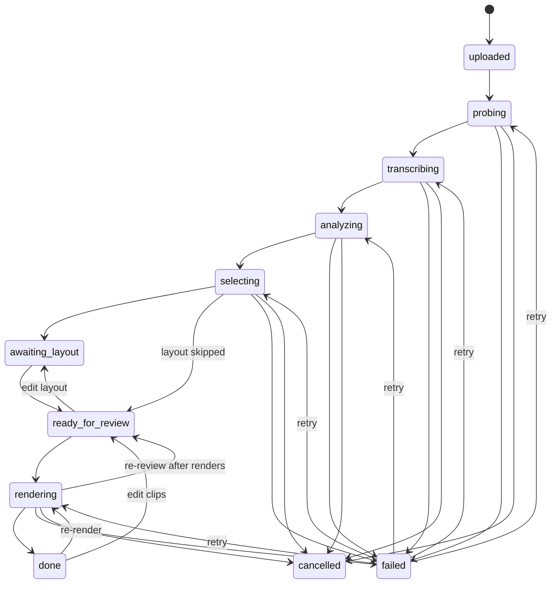

# Business logic

The product creates **drafts for human review**. Nothing is auto-published. Rendering finals always requires explicit clip approval. YouTube demonetizes templated, mass-produced content, so the review step and per-clip titles/hooks keep output varied.

## Entities

| Entity       | Key fields                                                                                                                                                                                                                                              |
| ------------ | ------------------------------------------------------------------------------------------------------------------------------------------------------------------------------------------------------------------------------------------------------- |
| Project      | id, name, sourceAssetId, status, failedStep, error, settings snapshot (captionStyle, clipMinMs, clipMaxMs, selectorMode, targetClipCount), createdAt, updatedAt                                                                                         |
| Asset        | id, projectId, kind (`source` · `audio` · `thumbnail` · `proxy` · `render` · `subtitle`), storageKey, mime, bytes, durationMs, width, height, fps, codec                                                                                                |
| Transcript   | projectId, language, words[] `{text, startMs, endMs, confidence}`, segments[] `{text, startMs, endMs, firstWord, lastWord}`                                                                                                                             |
| Signals      | projectId, silences[] `{startMs, endMs}`, loudness[] (LUFS, 1 sample / 250 ms), speechDensity[] (words per second per 10 s window)                                                                                                                      |
| Layout       | projectId, sourceAspect (`16:9` · `16:10` · `4:3` · `21:9` · `other`), webcamRect `{x,y,w,h}` normalized 0–1 or null, gameplayRect, gameplayFocusX 0–1, mode (`cam-top` · `split-50` · `no-cam-fill` · `no-cam-blur-fill`), confidence, confirmedByUser |
| LayoutPreset | width, height (unique pair), webcamRect, gameplayRect, mode, gameplayFocusX                                                                                                                                                                             |
| Clip         | id, projectId, startMs, endMs, title, hook, reason, score 0–1, status (`candidate` · `approved` · `rejected` · `rendering` · `rendered` · `failed`), captionOverrides, renderAssetId, error                                                             |
| CaptionStyle | presetId + overrides (fontFamily, fontSize, primary/highlight color token, outline, position, maxWordsPerPage, maxCharsPerLine, uppercase)                                                                                                              |
| Job          | id, projectId, type, payload, status (`queued` · `running` · `succeeded` · `failed` · `cancelled`), attempts, maxAttempts, runAfter, leasedUntil, leaseOwner, progress 0–100, error, timestamps                                                         |
| Setting      | key, value (JSON, zod-validated per key)                                                                                                                                                                                                                |

## Project state machine

- Illegal transitions throw `AppError("INVALID_TRANSITION")`.
- "Running" states: `probing`, `transcribing`, `analyzing`, `selecting`, `rendering`. Only these can go to `failed` or `cancelled`.
- On failure the project stores `failedStep`. `retry` is legal only from `failed` and returns to exactly `failedStep`.
- `cancelled` is terminal except for deletion.
- `done → rendering` covers re-rendering an edited clip. `done → ready_for_review` covers approving more clips.

## Rules and defaults

### Link imports

- Accepted: `http`/`https` links with a public hostname. `localhost`, `*.local`, `*.localhost`, `*.internal`, IP literals in private ranges and IPv6 literals are rejected ("Paste a link to a video"). The fragment is dropped; max 2048 characters.
- The project is named `<site> <video id>` until yt-dlp returns the title, then renamed to the title (first 120 characters).
- The same `MAX_UPLOAD_BYTES` limit applies, checked against yt-dlp's size estimate and enforced with `--max-filesize`. Disk space is checked against the estimate.
- Only import videos you own or have rights to; the dashboard says so.

### Probing

- Accepted containers: mp4, mov, mkv, webm. Must contain at least one video stream and one audio stream. Otherwise fail with a human-readable message ("This file has no audio track").
- Max upload: `MAX_UPLOAD_BYTES` (default 20 GiB).
- Aspect classification on display aspect ratio `r = w / h` (after rotation/SAR):
  - `16:9`, `16:10`, `4:3` when within 2% of that ratio
  - `21:9` when `r ∈ [2.33 × 0.98, 2.40 × 1.02]` (covers 2.33–2.40 plus 2% tolerance)
  - `other` otherwise
- Thumbnail at 10% of duration (JPEG, 640 px wide). Proxy: 640 px wide H.264 `-crf 30 -preset veryfast`, AAC 96k, `+faststart`.

### Transcription

- Audio: 16 kHz mono PCM WAV.
- Word normalization (pure, `features/transcription/normalize.ts`):
  1. Trim whitespace; drop empty tokens.
  2. Merge tokens that are only punctuation into the previous word (`"hello" "," → "hello,"`).
  3. Merge whisper sub-word tokens that don't start with a space into the previous word.
  4. Sort by `startMs`, clamp `endMs ≥ startMs`.
  5. Fix overlaps: if `word[i].startMs < word[i-1].endMs`, set `word[i-1].endMs = word[i].startMs`.
  6. Confidence clamped to `[0, 1]` (missing → 1, non-numeric → 0). A merged word's confidence is the mean of its parts.
  7. Tokens with non-finite times are dropped; negative times clamp to 0. Words starting at or after the media duration are dropped.
- Segments: split on sentence-final punctuation (`.` `?` `!` `…`) or on gaps ≥ 1000 ms.

### Analysis

| Setting                  | Default                                          |
| ------------------------ | ------------------------------------------------ |
| silence noise threshold  | −35 dB                                           |
| silence min duration     | 500 ms                                           |
| loudness sample interval | 250 ms (ebur128 momentary loudness, downsampled) |
| speech density window    | 10 s, step 5 s                                   |

### Selection

| Setting                   | Default                                                             |
| ------------------------- | ------------------------------------------------------------------- |
| candidates                | 8–15 (target 12)                                                    |
| clip length               | 15–60 s                                                             |
| boundary snap window      | ±1.5 s to the nearest sentence boundary, else nearest word boundary |
| max overlap between clips | 20% of the shorter clip                                             |
| LLM repair retries        | 1, then heuristic fallback (logged)                                 |

Post-processing applies to every selector, in this order: clamp to media bounds → snap start/end to sentence boundaries within ±1.5 s, else to the nearest word boundary → enforce length bounds (extend or shrink at the end, on word boundaries) → drop if still out of bounds → remove overlaps greedily by score → sort by score desc → cap at max count.

HeuristicSelector (`features/highlights/heuristic.ts`) scores windows that start at every sentence and every 5 s, at the minimum and middle clip lengths. Each signal is measured against the 2 minutes either side of the window, so a loud game section or a fast-talking streamer doesn't drown everything else:

| Signal              | Weight | Measure                                                                                                    |
| ------------------- | ------ | ---------------------------------------------------------------------------------------------------------- |
| loudness spike      | 0.30   | 90th-percentile loudness minus the surrounding mean                                                        |
| speech rate         | 0.15   | words per second over the surrounding rate, minus 1 (capped at 2)                                          |
| excitement          | 0.15   | laughter tokens (`hahaha`, `kkkk`, `jajaja`, `rsrs`, `[laughs]`…) and `!`, above 1.5× the surrounding rate |
| reaction phrases    | 0.15   | phrases from `phrases/<language>.json` plus the project's catchphrases, above 1.5× the surrounding rate    |
| repeated words      | 0.10   | the same word three times within 3 s ("vai vai vai")                                                       |
| pause before peak   | 0.10   | a silence ends in the 3 s before the window's loudest moment                                               |
| question and answer | 0.05   | a question followed by a non-question                                                                      |

Each signal is divided by its 95th percentile across all windows and capped at 1. The weighted sum is multiplied by `0.4 + 0.6·mean word confidence`, so unclear speech (usually game dialogue in another language) scores lower. Phrases are matched without accents or case.

"Find more highlights" re-runs selection with every existing clip, rejected ones included, as excluded ranges: the same overlap rule applies against them, and Claude is told not to pick them again. New candidates are added; nothing is replaced.

The Claude selector is told the spoken language (titles and hooks are written in it) and sees low-confidence segments marked `(unclear)`. Transcripts over ~60k characters are split into parts with a minute of overlap, sent in parallel, each asking for its share of the clips plus two; post-processing merges them.

### Layout

- Every landscape source (`w ≥ 1.2 h`, whatever its class) goes through `awaiting_layout` with `cam-top` proposed. Square and portrait sources skip it with `no-cam-blur-fill`. A LayoutPreset for the exact source resolution also skips it (preset applied, `confirmedByUser = true`).
- Detection proposes a rect plus confidence. Below 0.5 confidence or with no face, propose `no-cam-blur-fill`.
- Keyboard nudge: arrow = 0.5% of the frame, Shift+arrow = 5%.

### Rendering

- One job per approved clip. A failed clip doesn't fail the project. The project goes to `done` when no render jobs are queued or running, and at least one succeeded.
- Vertical profile: 1080×1920, fps = source fps if ≤ 60 else 30 (sources under 24 fps keep theirs), H.264 `-preset veryfast -crf 20`, `yuv420p`, AAC 160k, `+faststart`.
- `cam-top`: webcam crop covers the top 35% (1080×672), gameplay crop covers the bottom 65% (1080×1248), horizontal focus point `gameplayFocusX` (default 0.5).
- `split-50`: same as cam-top with a 50/50 split (1080×960 each).
- `no-cam-fill`: a 9:16 crop of the gameplay rect scaled to 1080×1920, positioned by `gameplayFocusX`. The usual Shorts look when there's no webcam.
- `no-cam-blur-fill`: source scaled to cover 1080×1920, boxblur 20, darkened; the whole source fitted inside 1080×1920 (contain), centered on top.
- Horizontal edit: source resolution, silences longer than 1000 ms removed, 150 ms of padding kept on each side of every cut, subtitles burned in.
- Disk check: refuse to start a render when free space < 2× the estimated output size (bitrate × duration) + 500 MB.

### Captions

| Setting                   | Default                                                                                                                                    |
| ------------------------- | ------------------------------------------------------------------------------------------------------------------------------------------ |
| max lines per page        | 2                                                                                                                                          |
| max chars per line        | 28                                                                                                                                         |
| words per page            | 1–4                                                                                                                                        |
| never cross a silence gap | > 600 ms                                                                                                                                   |
| highlight                 | current word                                                                                                                               |
| safe area (9:16)          | baseline at 72% of the height in cam-top (inside the gameplay area, clear of the webcam band), 80% in no-cam-blur-fill, 72% in no-cam-fill |
| page breaks               | after a sentence end (`.`, `!`, `?`, `…`), before a gap > 600 ms, at the word limit, or when the words no longer fit the lines             |
| page timing               | a page stays up until the next page starts or 400 ms after its last word, whichever is first                                               |
| line breaking             | one line if it fits, otherwise the split that minimizes the widest line; a single word longer than the limit gets its own line             |
| page text edits           | replace the page's words; the new words share the page's time evenly                                                                       |

### Originality guardrail

- No "auto-render all" without approval. "Render approved" renders only clips with status `approved`.
- Every clip carries its own title and hook. The UI surfaces both and invites editing before export.
