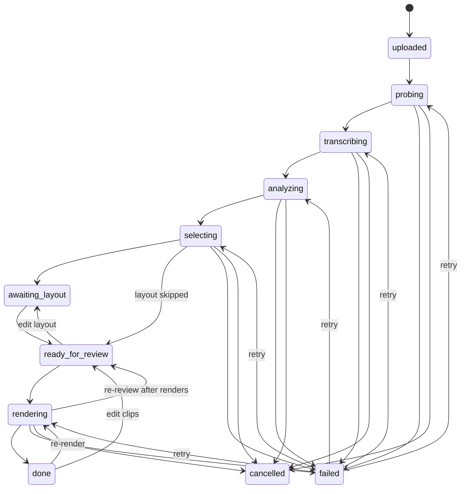

# Business logic

The product creates **drafts for human review**. Nothing is auto-published. Rendering finals always requires explicit clip approval. YouTube demonetizes templated, mass-produced content, so the review step and per-clip titles/hooks keep output varied.

## Entities

| Entity       | Key fields                                                                                                                                                                                                                                              |
| ------------ | ------------------------------------------------------------------------------------------------------------------------------------------------------------------------------------------------------------------------------------------------------- |
| Project      | id, name, sourceAssetId, status, failedStep, error, settings snapshot (captionStyle, clipMinMs, clipMaxMs, selectorMode, targetClipCount), createdAt, updatedAt                                                                                         |
| Asset        | id, projectId, kind (`source` · `audio` · `thumbnail` · `proxy` · `render` · `subtitle`), storageKey, mime, bytes, durationMs, width, height, fps, codec                                                                                                |
| Transcript   | projectId, language, words[] `{text, startMs, endMs, confidence}`, segments[] `{text, startMs, endMs, firstWord, lastWord}`                                                                                                                             |
| Signals      | projectId, silences[] `{startMs, endMs}`, loudness[] (LUFS, 1 sample / 250 ms), speechDensity[] (words per second per 10 s window)                                                                                                                      |
| Layout       | projectId, sourceAspect (`16:9` · `16:10` · `4:3` · `21:9` · `other`), webcamRect `{x,y,w,h}` normalized 0–1 or null, gameplayRect, gameplayFocusX 0–1, mode (`cam-top` · `split-50` · `no-cam-fill` · `no-cam-blur-fill`), confidence, confirmedByUser |
| LayoutPreset | width, height (unique pair), webcamRect, gameplayRect, mode, gameplayFocusX                                                                                                                                                                             |
| Clip         | id, projectId, startMs, endMs, title, hook, reason, score 0–1, status (`candidate` · `approved` · `rejected` · `rendering` · `rendered` · `failed`), captionOverrides, renderAssetId, error                                                             |
| CaptionStyle | presetId + overrides (font, fontSize, primary/highlight color token, outline, position, maxWordsPerPage, maxCharsPerLine, uppercase)                                                                                                                    |
| Job          | id, projectId, type, payload, status (`queued` · `running` · `succeeded` · `failed` · `cancelled`), attempts, maxAttempts, runAfter, leasedUntil, leaseOwner, progress 0–100, error, timestamps                                                         |
| Setting      | key, value (JSON, zod-validated per key)                                                                                                                                                                                                                |

## Project state machine

- Illegal transitions throw `AppError("INVALID_TRANSITION")`.
- "Running" states: `probing`, `transcribing`, `analyzing`, `selecting`, `rendering`. Only these can go to `failed` or `cancelled`.
- On failure the project stores `failedStep`. `retry` is legal only from `failed` and returns to exactly `failedStep`.
- `cancelled` is terminal except for deletion.
- `done → rendering` covers re-rendering an edited clip. `done → ready_for_review` covers approving more clips.

## Rules and defaults

### Link imports

- Accepted: `http`/`https` links with a public hostname. `localhost`, `*.local`, `*.localhost`, `*.internal`, IP literals in private ranges and IPv6 literals are rejected ("Paste a link to a video"). The fragment is dropped; max 2048 characters.
- The project is named `<site> <video id>` until yt-dlp returns the title, then renamed to the title (first 120 characters).
- The same `MAX_UPLOAD_BYTES` limit applies, checked against yt-dlp's size estimate and enforced with `--max-filesize`. Disk space is checked against the estimate.
- Only import videos you own or have rights to; the dashboard says so.

### Probing

- Accepted containers: mp4, mov, mkv, webm. Must contain at least one video stream and one audio stream. Otherwise fail with a human-readable message ("This file has no audio track").
- Max upload: `MAX_UPLOAD_BYTES` (default 20 GiB).
- Aspect classification on display aspect ratio `r = w / h` (after rotation/SAR):
  - `16:9`, `16:10`, `4:3` when within 2% of that ratio
  - `21:9` when `r ∈ [2.33 × 0.98, 2.40 × 1.02]` (covers 2.33–2.40 plus 2% tolerance)
  - `other` otherwise
- Thumbnail at 10% of duration (JPEG, 640 px wide). Proxy: 640 px wide H.264 `-crf 30 -preset veryfast`, AAC 96k, `+faststart`.

### Transcription

- Audio: 16 kHz mono PCM WAV.
- Word normalization (pure, `features/transcription/normalize.ts`):
  1. Trim whitespace; drop empty tokens.
  2. Merge tokens that are only punctuation into the previous word (`"hello" "," → "hello,"`).
  3. Merge whisper sub-word tokens that don't start with a space into the previous word.
  4. Sort by `startMs`, clamp `endMs ≥ startMs`.
  5. Fix overlaps: if `word[i].startMs < word[i-1].endMs`, set `word[i-1].endMs = word[i].startMs`.
  6. Confidence clamped to `[0, 1]` (missing → 1, non-numeric → 0). A merged word's confidence is the mean of its parts.
  7. Tokens with non-finite times are dropped; negative times clamp to 0. Words starting at or after the media duration are dropped.
- Segments: split on sentence-final punctuation (`.` `?` `!` `…`) or on gaps ≥ 1000 ms.

### Analysis

| Setting                  | Default                                          |
| ------------------------ | ------------------------------------------------ |
| silence noise threshold  | −35 dB                                           |
| silence min duration     | 500 ms                                           |
| loudness sample interval | 250 ms (ebur128 momentary loudness, downsampled) |
| speech density window    | 10 s, step 5 s                                   |
| camera cut detection     | proxy at 10 fps, 160×90, scene score > 0.25      |

### Selection

| Setting                   | Default                                                             |
| ------------------------- | ------------------------------------------------------------------- |
| candidates                | 8–15 (target 12)                                                    |
| clip length               | 15–60 s                                                             |
| boundary snap window      | ±1.5 s to the nearest sentence boundary, else nearest word boundary |
| max overlap between clips | 20% of the shorter clip                                             |
| LLM repair retries        | 1, then heuristic fallback (logged)                                 |

Post-processing applies to every selector, in this order: clamp to media bounds → snap start/end to sentence boundaries within ±1.5 s, else to the nearest word boundary (after the visual review, starts only snap to a word start within 400 ms, so a payoff start isn't pulled back to the sentence before it) → enforce length bounds (extend or shrink at the end, on word boundaries) → drop if still out of bounds → multiply the score by `1 − 0.6 × share covered by game dialogue` → remove overlaps greedily by score → sort by score desc → cap at max count.

Clips are meant to be action and loud reactions, not story. Game dialogue stretches (`features/highlights/game-dialogue.ts`) are likely cutscenes: the transcript is cut into 5 s bins, and a bin is game dialogue when it has at least two function words exclusive to another language and more of them than function words of the streamer's language (the lists from ADR-0046). Runs of such bins, bridging one-bin gaps, that last 20 s or more are stretches. They only exist when the game's language differs from the streamer's.

HeuristicSelector (`features/highlights/heuristic.ts`) scores windows that start at every sentence and every 5 s, at the minimum and middle clip lengths. Each signal is measured against the 2 minutes either side of the window, so a loud game section or a fast-talking streamer doesn't drown everything else:

| Signal              | Weight | Measure                                                                                                             |
| ------------------- | ------ | ------------------------------------------------------------------------------------------------------------------- |
| loudness spike      | 0.30   | 90th-percentile loudness minus the surrounding mean                                                                 |
| speech rate         | 0.15   | streamer words per second over the surrounding rate, minus 1 (capped at 2)                                          |
| excitement          | 0.15   | streamer laughter tokens (`hahaha`, `kkkk`, `jajaja`, `rsrs`, `[laughs]`…) and `!`, above 1.5× the surrounding rate |
| reaction phrases    | 0.15   | phrases from `phrases/<language>.json` plus the project's catchphrases, above 1.5× the surrounding rate             |
| repeated words      | 0.10   | the streamer says the same word three times within 3 s ("vai vai vai")                                              |
| pause before peak   | 0.10   | a silence ends in the 3 s before the window's loudest moment                                                        |
| question and answer | 0.05   | a question followed by a non-question                                                                               |
| YouTube replays     | 0.20   | the replay heatmap over the window minus its median, full weight at +0.5; only when the video has one               |

Streamer words are the transcript without game dialogue and hallucination loops (`speakerWords`, the same filter captions use), so a cutscene's dense dialogue doesn't read as the streamer talking fast. Each signal except YouTube replays is divided by its 95th percentile across all windows and capped at 1 (the heatmap is already 0–1 per video, and rescaling it would give a flat heatmap's noise full weight). The weighted sum is divided by the total weight of the signals in use, so projects without a heatmap score exactly as before. The weighted sum is multiplied by `0.4 + 0.6·mean word confidence`, so unclear speech (usually game dialogue in another language) scores lower. Phrases are matched without accents or case.

"Find more highlights" re-runs selection with every existing clip, rejected ones included, as excluded ranges: the same overlap rule applies against them, and Claude is told not to pick them again. New candidates are added; nothing is replaced.

The Claude selector is told to rank action with a loud reaction first, then big reactions, then heated rants, and never to pick cutscenes, menus, shops, calm exploring or chat talk. It is told the spoken language (titles and hooks are written in it), sees segments in another language marked `(game)` and low-confidence ones `(unclear)`, the game dialogue stretches, runs of three or more camera cuts at most 10 s apart (a hint, since chases and fail screens cut too) and, when there is a heatmap, the eight most replayed ranges above its median. Each project has a niche (`features/highlights/niches.ts`: GTA, open world, horror, shooter, racing, general, or auto). Auto matches keywords in the project name, which is the video title for imports, and falls back to general. The niche adds a list of what hooks viewers in that game (for GTA: bugs and glitches, physics chaos, chases, NPC weirdness, stunts) to both Claude prompts. Clips start at most a second or two before the payoff.

The visual review scores each candidate from its frames: 0.8–1 only for something visually striking with a reaction, under 0.3 for menus, cutscenes, calm driving or frames that don't match the transcript's excitement. Its score replaces the first pass's. A start or end more than 5 s outside the candidate (8 s before the start, given the lead-in) is ignored and the original range kept. A candidate the reviewer leaves out keeps half its first-pass score.

Transcripts over ~60k characters are split into parts with a minute of overlap, sent in parallel, each asking for its share of the clips plus two; post-processing merges them.

### Layout

- Every landscape source (`w ≥ 1.2 h`, whatever its class) goes through `awaiting_layout` with `cam-top` proposed. Square and portrait sources skip it with `no-cam-blur-fill`. A LayoutPreset for the exact source resolution also skips it (preset applied, `confirmedByUser = true`).
- Detection proposes a rect plus confidence. Below 0.5 confidence or with no face, propose `no-cam-blur-fill`.
- In webcam modes the webcam goes on top by default; `camPosition: "bottom"` swaps the two stacked regions, and "auto" captions move with the gameplay so they stay off the face.
- A clip can override the project layout (mode, webcam box, gameplay box, webcam position) from its editor; renders use `clips.layout_override` when set. Caption position (auto, top, middle, bottom) is a per-clip caption style override.
- Gameplay box: in every mode but `no-cam-blur-fill`, the gameplay crop is a dashed box on the source that can be dragged and resized like the webcam box. Its shape is locked to the slot it fills (1080×1248 in cam-top, 1080×960 in split-50, 1080×1920 in no-cam-fill). It starts at the current crop, `coverCrop(gameplayRect, slot, gameplayFocusX)`; an edit stores the box as `gameplayRect` and sets `gameplayFocusX` to 0.5, so the crop is the box itself. Switching mode refits an edited box to the new slot around its centre, with the same area where it fits, inside the frame (a box at full size stays at full size); an untouched layout keeps its rect and focus, so its crop is the same as before.
- Keyboard nudge: arrow = 0.5% of the frame, Shift+arrow = 5%.

### Rendering

- One job per approved clip. A failed clip doesn't fail the project. The project goes to `done` when no render jobs are queued or running, and at least one succeeded.
- Vertical profile: 1080×1920, fps = source fps if ≤ 60 else 30 (sources under 24 fps keep theirs), H.264 `-preset veryfast -crf 20`, `yuv420p`, AAC 160k, `+faststart`.
- `cam-top`: webcam crop covers the top 35% (1080×672), gameplay crop covers the bottom 65% (1080×1248), horizontal focus point `gameplayFocusX` (default 0.5).
- `split-50`: same as cam-top with a 50/50 split (1080×960 each).
- `no-cam-fill`: a 9:16 crop of the gameplay rect scaled to 1080×1920, positioned by `gameplayFocusX`. The usual Shorts look when there's no webcam.
- `no-cam-blur-fill`: source scaled to cover 1080×1920, boxblur 20, darkened; the whole source fitted inside 1080×1920 (contain), centered on top.
- Horizontal edit: source resolution, silences longer than 1000 ms removed, 150 ms of padding kept on each side of every cut, subtitles burned in.
- Disk check: refuse to start a render when free space < 2× the estimated output size (bitrate × duration) + 500 MB.

### Effects

A clip's `effects` is `{ events, edited }` or null. Null renders and previews exactly as before effects existed. Event times are absolute source ms, so a trim keeps them where they are in the recording; saving drops events outside the clip and clips the ones crossing its edges.

| Kind    | What it does                                                                                                                                                                                     | Defaults                                                              |
| ------- | ------------------------------------------------------------------------------------------------------------------------------------------------------------------------------------------------ | --------------------------------------------------------------------- |
| `focus` | `target: "cam"` (full cam): the webcam fills 9:16. `target: "game"` (full game): the 9:16 cover crop of the gameplay rect at `gameplayFocusX` fills the frame, the same framing as `no-cam-fill` | `target` cam; ignored (kept, greyed out in the editor) with no webcam |
| `zoom`  | punches in on the gameplay region                                                                                                                                                                | `scale` 1.1–2.0 (1.4), `focus` x/y 0–1 (centre), 150 ms ease in/out   |
| `shake` | jitters the frame at ~12 Hz, slightly zoomed in                                                                                                                                                  | `intensity` light (1.06×) or strong (1.12×), 300–800 ms               |

Same-kind events never overlap; a shake can overlap anything; a zoom inside full cam has no effect, and inside full game it zooms the full-frame gameplay (its `focus` is relative to that crop). `frameAt` (`features/effects/frame.ts`) turns the layout, source size, events and a time into crop rects, and both the canvas preview and the render use it. Captions are drawn on the final frame and never move.

Planner (`features/effects/planner.ts`, constants in `PLANNER`), in priority order:

- **Review beats**: a `reaction` beat → full cam focus from 300 ms before to 1.5 s after (webcam layouts only); a `weird` beat → 1.5 s zoom centred on it, at the beat's x/y (a share of the full frame) converted to the gameplay crop that zoom scales, i.e. the cover crop `planLayout` cuts from the gameplay rect. Beats snap to the loudest loudness window within ±2.5 s and inside the clip (unless tied), else to the fastest speech-rate window, else stay put. Beats may start in the lead-in.
- **Screams**: windows ≥ 8 LU over the clip's median loudness and above −18 LUFS → a 500 ms shake (strong at +14 LU) plus a focus when there's a webcam and no focus already covers it.
- **Jumps** (only without beats): a window ≥ 10 LU above the 1.5 s before it → a 1.5 s centre zoom.

The planner only ever creates full cam; full game is added by hand. Caps: at most one effect start per 3 s (shakes included), focus at most 40% of the clip (over budget, a scream keeps only its shake), at most 4 shakes, and nothing starts in the first 500 ms except beats.

When tracks change:

- Selection plans a track for every new clip when the project's `autoEffects` is on (default), Claude, heuristic and pasted clips alike. Beats are stored on the clip so planning again never calls Claude.
- Turning `autoEffects` on plans every track that isn't `edited`; turning it off sets them to null. Edited tracks are never touched. If clips are rendered, the settings form offers a render re-run.
- Confirming or changing the project layout (with `autoEffects` on) re-plans every track that isn't `edited`, null ones included, on clips without a layout override, in the same transaction. Selection runs before webcam detection, so without a preset its tracks were planned against the probe's webcam-less placeholder.
- Saving a trim or a different clip layout re-plans an existing track that isn't `edited` over the clip's range, with the layout being saved. A null track stays null. Any change to the events sets `edited: true`; an edited track only has out-of-range events dropped on trim.
- "Reset to auto" / "Add effects automatically" in the editor call `planClipEffectsAction`, which returns a fresh plan for the range and layout on screen without saving it. It's saved with the rest of the clip.

### Captions

| Setting                   | Default                                                                                                                                                      |
| ------------------------- | ------------------------------------------------------------------------------------------------------------------------------------------------------------ |
| max lines per page        | 2                                                                                                                                                            |
| max chars per line        | 28                                                                                                                                                           |
| words per page            | 1–4                                                                                                                                                          |
| never cross a silence gap | > 500 ms                                                                                                                                                     |
| highlight                 | current word                                                                                                                                                 |
| safe area (9:16)          | baseline at 72% of the height in cam-top (inside the gameplay area, clear of the webcam band), 80% in no-cam-blur-fill, 72% in no-cam-fill                   |
| page breaks               | after a sentence end (`.`, `!`, `?`, `…`), before a gap > 500 ms, at the word limit, or when the words no longer fit the lines                               |
| page timing               | a page stays up until the next page starts or 300 ms after its last word, whichever is first                                                                 |
| line breaking             | one line if it fits, otherwise the split that minimizes the widest line; a single word longer than the limit gets its own line                               |
| word length               | a word stays lit at most 300 ms + 80 ms per character (max 1.2 s); longer whisper timings are cut so captions clear during pauses                            |
| who is captioned          | only the streamer's language: segments whose function words belong to another language are dropped, and repeats of a line said 3+ times in a row are dropped |
| page text edits           | replace the page's words; the new words share the page's time evenly                                                                                         |

### Channel playbook

- A rule is a short instruction (max 200 characters) for one target: `selection` (picking clips) or `review` (editing clips). A channel holds at most 12 active rules per target.
- Rules are immutable. Editing creates a new rule that supersedes the old one; retiring sets its status to `retired`. A retired rule can be restored, which flips its status back and still has to fit the cap, otherwise a rule must be retired in its place.
- Claude only suggests. A suggestion to add, edit or retire stays pending until a person approves or rejects it. A new analysis replaces pending suggestions and keeps rejected ones.
- Rule changes on a channel run one at a time, and a suggestion can be decided once.
- Active rules reach the prompts only when the channel has any, and each clip stores the rule ids it was picked under.

### Analytics

- A publication is `nimbus` (published from a clip) or `imported` (found on the channel). Imported Shorts have no clip, transcript or moments.
- A video is a Short when `0 < duration <= 180 s`, unless a per-video `creatorContentType` probe answered, in which case `SHORTS` decides (`VIDEO_ON_DEMAND` is long, anything else other). Only Shorts are imported.
- Same-age ratio: a Short's cumulative views at age N (its age capped at 28 days) over the median of the other Shorts' cumulative views at the same age. Under 2 days of age, or with fewer than 3 peers, there is no ratio.
- Data lags 48 to 72 hours, so ages and periods end at the last day with data. A Short's data ends at `min(dataThrough, max(lastStoredDay, pacificDay(dailySyncedAt) - 3))`; days a successful read omits inside that range count as 0 views.
- Refresh cadence: Nimbus Shorts sync at days 1, 2, 7 and 28. After 28 days, and for every imported Short, a sync is due every 28 days, which keeps `videos.list` data inside the 30-day rule. Uploads and channel totals sync daily.
- Periods are 7, 28 or 90 days. Each total is compared with the previous period of the same length; the change is empty when the previous period has no data.
- A private or deleted imported Short is `removed`. A Nimbus upload that turns private stays `published`.

### Originality guardrail

- No "auto-render all" without approval. "Render approved" renders only clips with status `approved`.
- Every clip carries its own title and hook. The UI surfaces both and invites editing before export.
